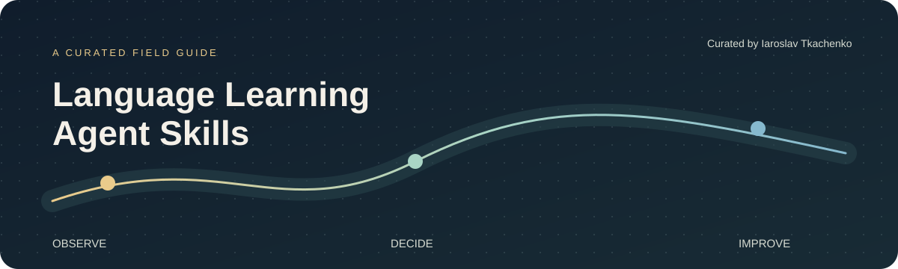
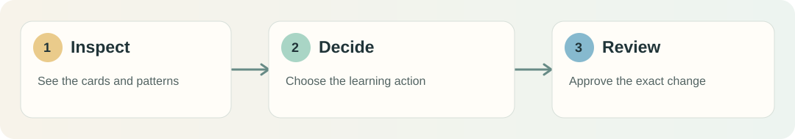

# Language Learning Agent Skills

**A curated field guide to using AI agents for more intentional language study.**

Collected by [Iaroslav Tkachenko](https://github.com/iaroslav-tkachenko) · Original skills and carefully credited discoveries

[Explore Anki skills](#start-here-anki) · [My skills](#my-skills) · [How this collection works](#how-this-collection-works)

> **The idea**  
> A useful agent should help you notice what is hard, choose what to practice, and make a clear change you can review. This collection maps practical agent skills to those moments in language learning.

Коротко по-русски

Это каталог агентских навыков для изучения языков. Здесь будут мои собственные навыки и отдельная подборка работ других авторов. Сейчас в подборке два проекта для Anki: один помогает находить трудные карточки и аккуратно улучшать их, второй даёт агенту общий способ работать с Anki через AnkiConnect. Чужие файлы здесь не копируются: рядом с каждым проектом указаны автор, первоисточник и лицензия.

## Start here: Anki

Two complementary skills for working with an Anki collection. They are **independent projects by other authors**, linked here with attribution. This repository does not redistribute their code or claim to maintain them.

| Skill | What it helps you do | Best starting point | Creator |
| :-- | :-- | :-- | :-- |
| **[Anki collection assistant](https://github.com/djt97/anki-skill)** | Inspect a collection, find cards that consume review time, and propose small, reviewable improvements. | “Which cards keep slowing me down, and why?” | [DJ Thornton / djt97](https://github.com/djt97) |
| **[AnkiConnect](https://github.com/intellectronica/agent-skills/blob/main/skills/anki-connect/SKILL.md)** | Give an agent a general route to Anki decks, notes, cards, media, and AnkiConnect actions. | “Help me inspect or organize a specific part of my Anki collection.” | [intellectronica](https://github.com/intellectronica) |

**Choose by task:** start with **Anki collection assistant** for a guided collection health check and careful card rewrites. Start with **AnkiConnect** when you already have a specific Anki operation in mind. Both require local Anki Desktop and the AnkiConnect add-on; read each author's current instructions before installing or allowing changes.

 Figure 1. A study-first workflow: inspect → decide → review. The diagram is original to this catalog; it is not part of either linked skill.

### Source and rights

| Linked project | Original material | License shown by its repository |
| :-- | :-- | :-- |
| Anki collection assistant | [Repository and installation guide](https://github.com/djt97/anki-skill) · [skill file](https://github.com/djt97/anki-skill/blob/main/anki/SKILL.md) | [MIT](https://github.com/djt97/anki-skill/blob/main/LICENSE) |
| AnkiConnect | [Skill file](https://github.com/intellectronica/agent-skills/blob/main/skills/anki-connect/SKILL.md) · [parent repository](https://github.com/intellectronica/agent-skills) | [CC0 1.0](https://github.com/intellectronica/agent-skills/blob/main/LICENSE.txt) |

Descriptions here are original summaries. Ownership, maintenance, installation instructions, and applicable licenses remain with the linked projects. License information was checked on **13 October 2026**; follow the current upstream files if anything changes.

## My skills

This space is reserved for skills I create and maintain. **No original skills are published here yet.** As they are ready, each will have its own `skills/<name>/SKILL.md`, a short use case, requirements, examples, and an explicit license.

| Planned area | What I want the agent to help with |
| :-- | :-- |
| Vocabulary in context | Turn words encountered in reading and listening into useful practice decisions. |
| Speaking and writing | Find recurring patterns in my own output and plan focused practice. |
| Study reflection | Connect practice data with the next concrete learning action. |

These are directions for the collection, not published skill files or a delivery promise.

## How this collection works

| Label | What it means | Where to find it |
| :-- | :-- | :-- |
| **Created here** | An original skill authored and maintained in this repository. | A complete file under `skills/` with its own license. |
| **Curated link** | A third-party skill selected and described here. | A direct link to the creator's repository or skill file. |

Curated links are never presented as my work. I do not mirror third-party skill files, images, logos, or installation scripts here. If I later adapt someone else's work, I will identify the original, explain the changes, include the required notices, and check its license first.

The catalog is deliberately small. A new entry should answer **who made it, what learning task it serves, what it needs, where the original lives, and what a user should review before the agent acts**. See [CONTRIBUTING.md](CONTRIBUTING.md) for the entry format.

---

Made for language learners who want clearer practice, with full credit to the people building the tools.

